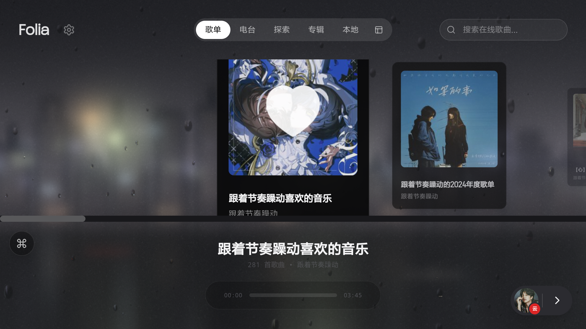
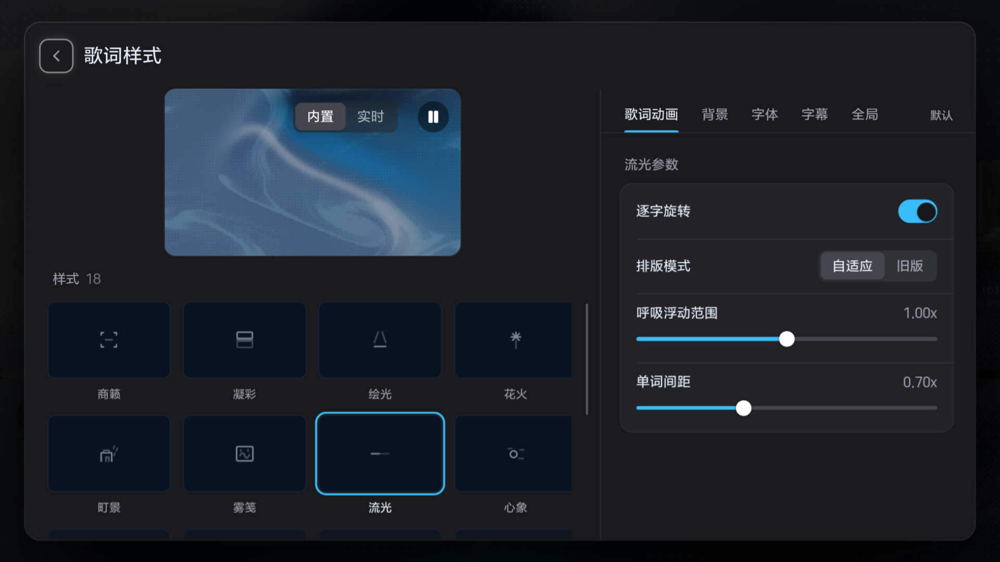
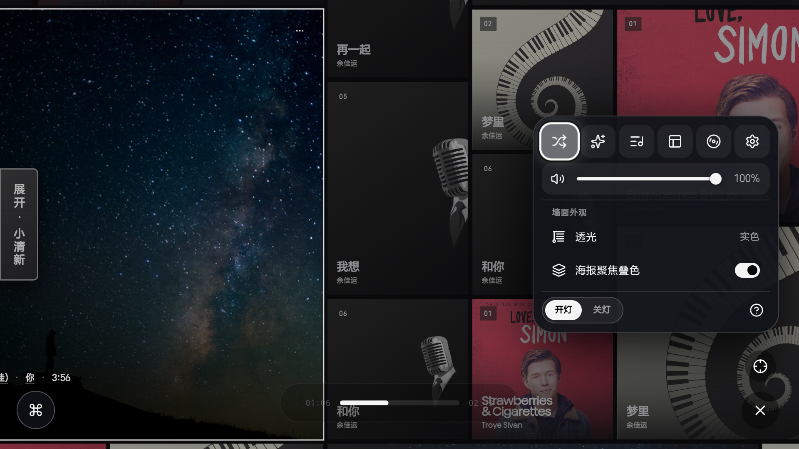
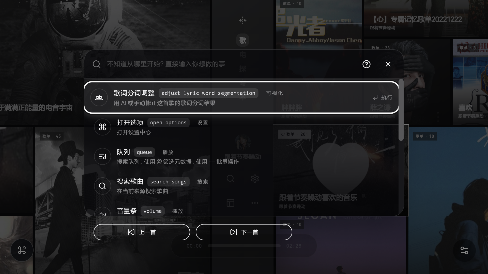
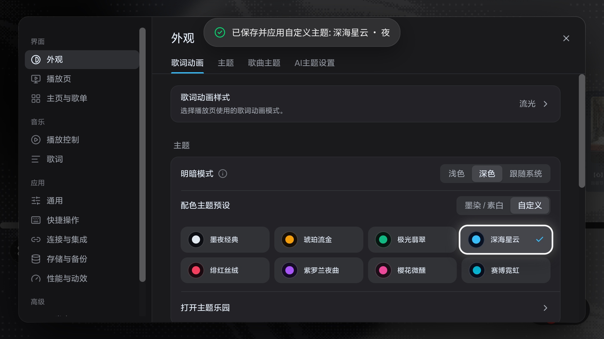
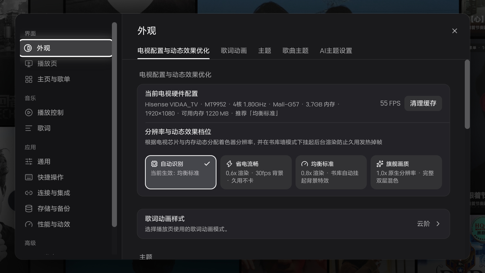
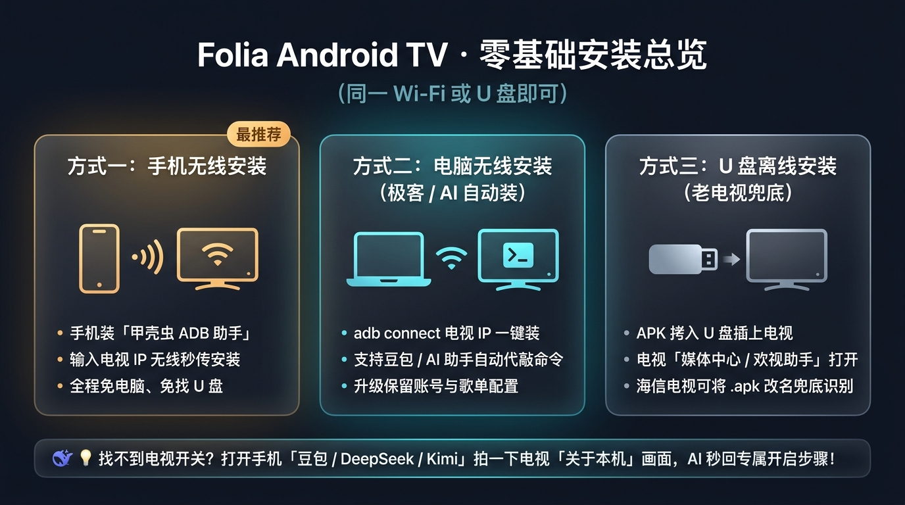
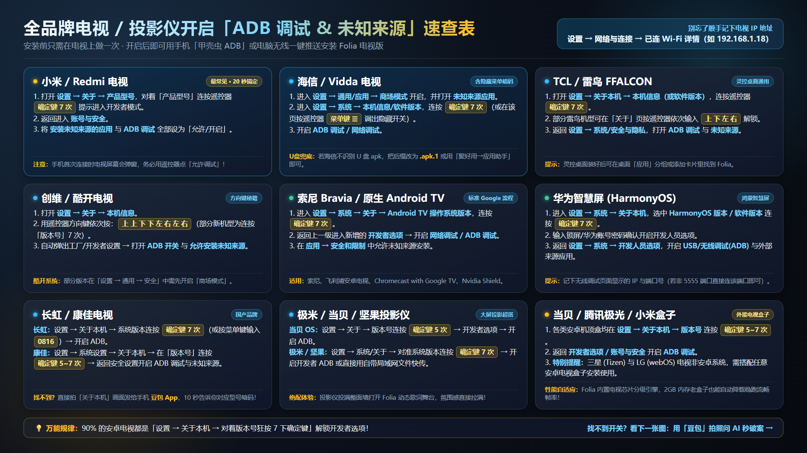
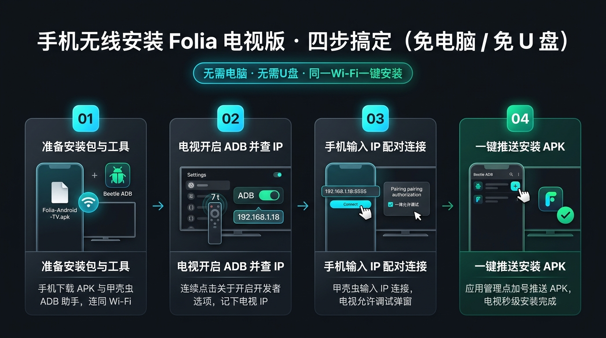
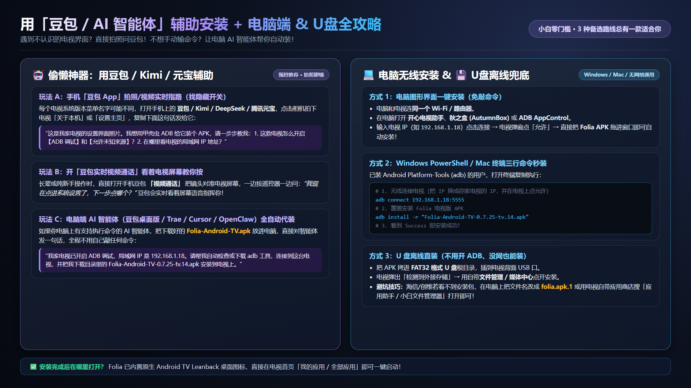

<div align="center">

# Folia Android TV · 电视大屏客户端

**Lyrics Reimagined for the Living Room // 辞曲新境 · 客厅大屏重构版**

[](https://github.com/miranda031/folia-android-tv/releases/latest)
[](https://github.com/miranda031/folia-android-tv/releases/latest)
[](LICENSE)

[**⬇️ 立即下载最新电视版 APK (v0.7.25-tv.14)**](https://github.com/miranda031/folia-android-tv/releases/download/v0.7.25-tv.14/Folia-Android-TV-0.7.25-tv.14.apk) · [**📺 零基础电视安装图文教程**](docs/TV_INSTALL_GUIDE.md) · [**上游桌面版仓库**](https://github.com/chthollyphile/folia-major)

</div>

---

## 项目简介

**Folia Android TV** 是基于开源沉浸式歌词音乐播放器 [Folia (`chthollyphile/folia-major`)](https://github.com/chthollyphile/folia-major) 与安卓移植底座 [`whycfawa/folia-android`](https://github.com/whycfawa/folia-android) 深度重构的**原生智能电视 / 投影仪 / 电视盒子大屏客户端**。

针对客厅 **3 米视距（10-foot UI）**、**纯遥控器五向键（D-Pad）盲操**以及**智能电视差异巨大的芯片与内存配置**，本项目从底层 Android 原生 Activity 到前端空间焦点引擎、主题工作台与着色器渲染管线进行了全方位电视化改造，让你在家中电视或整面投影墙上享受如同音乐艺术展般的沉浸式逐字歌词与音频可视化体验。

> [!TIP]
> **零门槛快速体验**：直接前往 [**Releases 页面**](https://github.com/miranda031/folia-android-tv/releases/latest) 下载签好名的 `Folia-Android-TV-0.7.25-tv.14.apk`，配合下方的 [**3 分钟保姆级电视安装图文教程**](#保姆级电视安装图文教程)（支持手机无线直装、豆包 AI 拍照指路、电脑 ADB 与 U 盘安装），任何品牌安卓电视一看就会！

---

## 电视端专属重构特性

| 核心模块 | 电视大屏重构亮点 |
| :--- | :--- |
| **原生 Android TV 宿主层** | 内置 `LEANBACK_LAUNCHER` 电视桌面高清横幅图标、横屏全屏沉浸模式、屏幕常亮防休眠保护，以及搜狗等电视输入法关闭后自动夺回 WebView 遥控焦点的防丢焦补丁。 |
| **9 层级遥控器空间焦点引擎** | 全新设计 `tvNavigationEngine` 2D 几何空间寻路与 **LIFO 返回键层级栈**：无论是弹窗、快捷下拉菜单、设置分页、侧边抽屉还是主页封面墙，遥控器上下左右键指哪打哪，绝无焦点死胡同，高对比发光焦点框一目了然。 |
| **Bravais 无限书库墙电视适配** | 支持遥控器在无限封面墙与顶部控制胶囊间丝滑穿梭；菜单最小化后提供常驻发光**边缘唤醒胶囊（Edge Handle）**；支持左侧 `⌘` 按钮或遥控器菜单键一键呼出**全局命令面板与快捷菜单**（快速搜歌而不会误弹全屏软键盘遮挡画面）。 |
| **8 款一键大屏主题 + 遥控调色** | 彻底解决原版触屏取色盘在电视上无法操作的问题！内置 **8 款电视精选高对比主题预设**（极夜流光、琥珀暖金、深海霓虹、樱霞微醺等），并将 HSV 调色盘改造为遥控器左右方向键步进调节。 |
| **电视硬件识别与自适应降载** | 原生 `TvHardwareBridge` 自动探测电视 CPU 核心数、运行内存（RAM）、GPU 型号与刷新率，智能匹配 **旗舰高刷 / 均衡标准 / 流畅优先 / 省电长稳** 四档渲染策略，内置 30 秒内存与掉帧守护看门狗，2GB 内存老电视连续播放数小时依然丝滑不卡顿！ |
| **在线音源 + 本地音乐 + 硬件媒体键** | 完整保留网易云、QQ 音乐、酷狗音乐、Navidrome 与本地音乐库支持；原生打通电视遥控器实体 **播放/暂停、上一首、下一首、快进/快退与菜单键**。 |

---

## 电视实机运行截图

<table>
  <tr>
    <td width="50%">
      
    </td>
    <td width="50%">
      
    </td>
  </tr>
  <tr>
    <td align="center"><strong>客厅 1080p/4K 专辑网格与高对比遥控器光标</strong></td>
    <td align="center"><strong>全屏沉浸式逐字歌词与实时音频可视化舞台</strong></td>
  </tr>
  <tr>
    <td width="50%">
      
    </td>
    <td width="50%">
      
    </td>
  </tr>
  <tr>
    <td align="center"><strong>Bravais 无限书库墙 & 遥控器高对比快捷菜单</strong></td>
    <td align="center"><strong>一键呼出全局命令面板（不误弹输入法遮挡视野）</strong></td>
  </tr>
  <tr>
    <td width="50%">
      
    </td>
    <td width="50%">
      
    </td>
  </tr>
  <tr>
    <td align="center"><strong>8 款大屏精选一键主题预设 & 遥控器调色滑块</strong></td>
    <td align="center"><strong>自动识别电视硬件配置 · 四档画质帧率自适应</strong></td>
  </tr>
</table>

---

## 电视遥控器按键速查

| 遥控器按键 | 功能说明 |
| :--- | :--- |
| **方向键 `↑` `↓` `←` `→`** | 在封面墙、顶部胶囊、快捷菜单、设置项与底部播控栏之间移动高亮焦点；在色彩/数值滑块上按 `←` / `→` 精细调节 |
| **确定键 `OK / Enter`** | 激活当前高亮按钮、播放选中歌曲、展开下拉快捷菜单；全屏歌词隐藏控制栏时按一下唤醒控制栏 |
| **返回键 `Back`** | 严格按层级依次关闭：下拉菜单 → 命令面板/设置弹窗 → 搜索抽屉 → 从播放舞台退回主页；在主页连按两次退出应用 |
| **菜单键 `☰`**（或界面左侧 `⌘`） | 在任意界面直接呼出 / 收起 **全局命令面板**（快速搜歌、切视图、换主题、打开设置） |
| **实体媒体键 `⏯` `⏮` `⏭`** | 全局直接控制播放/暂停、上一曲、下一曲 |

---

## 保姆级电视安装图文教程

> 完整细节与常见问题排错请查阅独立长文：👉 **[《Folia 电视版零基础保姆级安装图文教程》(docs/TV_INSTALL_GUIDE.md)](docs/TV_INSTALL_GUIDE.md)**

### 1. 一图看懂安装全流程
先在 [**Releases**](https://github.com/miranda031/folia-android-tv/releases/latest) 下载 `Folia-Android-TV-0.7.25-tv.14.apk`，确保手机/电脑与电视连在同一个路由器 Wi-Fi 下：



### 2. 全品牌电视 / 投影仪开启「ADB 调试 & 未知来源」速查表
无论是**小米/Redmi、海信/Vidda、TCL/雷鸟、创维/酷开、长虹、康佳、索尼、华为智慧屏**还是**极米/当贝/坚果投影仪**，对照下图 20 秒即可打开调试开关：



### 3. 最推荐：用手机「甲壳虫 ADB 助手」无线四步秒装
不用电脑也不用找 U 盘，安卓手机装个 **甲壳虫 ADB 助手**，输入电视 IP 点连接 → 在电视屏幕弹窗点「允许」→ 点 `+` 号选 APK 即可装好（苹果 iPhone 用户可在电视装「欢视助手 / 当贝市场」扫码网页上传）：



### 4. 偷懒神器：让「豆包 / AI 智能体」拍照指路，或用电脑 / U 盘安装
找不到自家老电视的隐藏菜单？打开手机 **豆包 / Kimi / DeepSeek** 拍一下电视设置界面发给它，或者开**豆包实时视频通话**让它看着屏幕教你按！电脑党也可用图形工具、3 行 ADB 命令或让电脑端 AI 智能体全自动代装：



---

## 本地开发与自行构建 APK

### 环境要求
- **Node.js** `>= 22`（推荐 Node 24 LTS）
- **JDK** `21`
- **Android SDK**（`compileSdk 36`，`minSdk 24`）

### 构建步骤

```bash
# 1. 克隆仓库并安装前端依赖
git clone https://github.com/miranda031/folia-android-tv.git
cd folia-android-tv
npm install

# 2. 构建前端资源并同步到 Capacitor Android 工程
npm run build
npx cap sync android

# 3. 编译 Android TV 安装包（Windows 下使用 gradlew.bat）
cd android
./gradlew assembleRelease
```

---

## 致谢与上游项目

本项目站在优秀的开源社区肩膀之上，特此向以下上游作者与贡献者致谢：

- **[chthollyphile/folia-major](https://github.com/chthollyphile/folia-major)** —— Folia 官方桌面与 Web 核心仓库（提供惊艳的歌词排版动画引擎、着色器视觉系统与多音源架构）。
- **[whycfawa/folia-android](https://github.com/whycfawa/folia-android)** —— Folia Android Capacitor 社区移植底座。
- **[amll-dev/amll-ttml-db](https://github.com/amll-dev/amll-ttml-db)**、**[chenmozhijin/LDDC](https://github.com/chenmozhijin/LDDC)**、**[chenglou/pretext](https://github.com/chenglou/pretext)** 等开源项目与社区贡献者。

## 法律与免责声明

本项目仓库及其源代码遵循 `AGPL-3.0` 开源许可证，仅供个人学习、大屏交互工程研究与非营利测试使用，请勿用于任何商业盈利用途。应用中涉及的在线音乐流媒体、歌词、专辑封面及其他内容版权均归对应权利人所有，请支持正版数字音乐。
