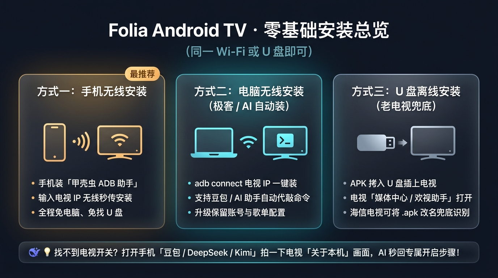
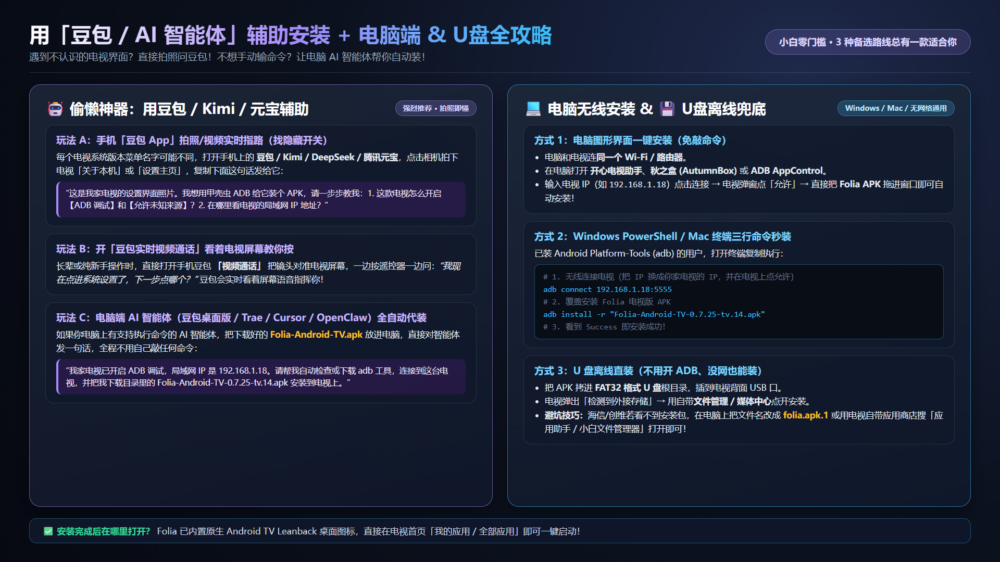
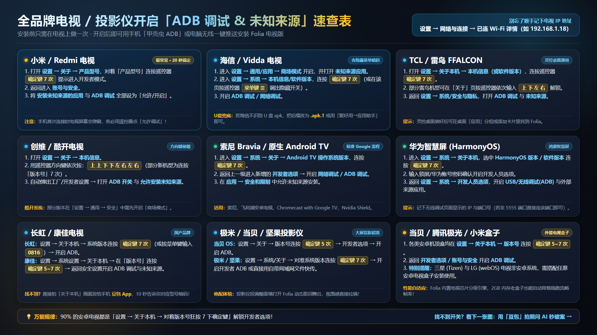
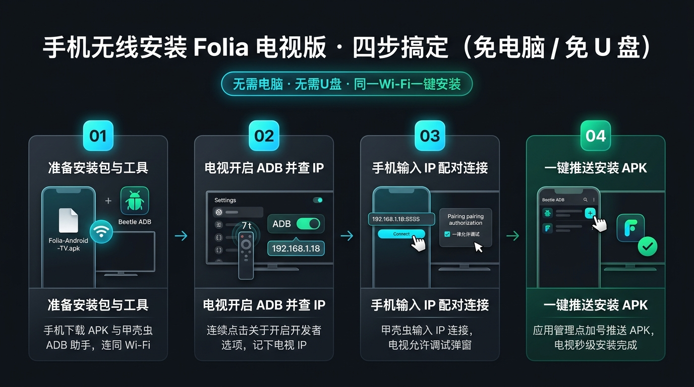

# Folia 电视版（Android TV）零基础保姆级安装图文教程

> **适用设备**：小米 / Redmi、海信 / Vidda、TCL / 雷鸟、创维 / 酷开、长虹、康佳、索尼 Bravia、华为智慧屏，以及极米 / 当贝 / 坚果投影仪、各类安卓电视盒子。  
> **预计耗时**：3 分钟 · 全程免费 · 新手跟着图片一步步点即可完成！



---

## 第一步：下载安装包 & 确认网络

1. **下载最新电视端专用 APK 安装包**：
   - **GitHub 官方直链下载**：[Folia-Android-TV-0.7.25-tv.14.apk](https://github.com/miranda031/folia-android-tv/releases/download/v0.7.25-tv.14/Folia-Android-TV-0.7.25-tv.14.apk)（或前往 [Releases 页面](https://github.com/miranda031/folia-android-tv/releases/latest) 下载最新版）。
   - 如果打算用**手机安装**，直接下载到手机里；如果用**电脑或 U 盘安装**，下载到电脑里即可。
2. **确保处于同一局域网**（无线安装必看）：
   - 让你的**手机或电脑**与**家里电视**连接**同一个路由器 / Wi-Fi**（例如都连家里的 Wi-Fi，电视插路由器网线、手机连同一个路由器的 Wi-Fi 也可以，只要别连“访客网络”即可）。
3. **查看并记下电视的 IP 地址**：
   - 在电视上进入 **设置 → 网络与连接 → 点击当前已连接的网络详情**，记下 `IP 地址`（格式通常为 `192.168.x.x`，例如 `192.168.1.18`）。

---

## 第二步：偷懒神器——让「豆包 / AI 智能体」手把手带你找开关或自动装

不同电视品牌的系统界面千差万别，如果找不到隐藏设置，或者不想自己敲命令，直接呼叫 **豆包、DeepSeek、Kimi、腾讯元宝** 等智能体帮你搞定！



### 玩法 1：手机「豆包 App」拍照识图 / 实时视频指路（强烈推荐）
1. 在手机上打开 **豆包 App**（或 Kimi / 腾讯元宝 / DeepSeek）。
2. 打开电视的 **「设置」** 或 **「关于本机」** 页面，用豆包输入框旁边的**相机拍照**，然后直接复制下面这段话发给它：

```text
这是我家电视的设置界面照片。我想用甲壳虫 ADB 助手给这台电视无线安装一个第三方 APK 应用，请根据照片里的电视品牌和系统版本，一步步教我：
1. 怎么用遥控器开启这台电视的【ADB 调试 / 网络调试】和【允许安装未知来源应用】？（如果有隐藏按键密码请告诉我）
2. 在哪个菜单查看这台电视的局域网 IP 地址？
```

> **长辈/纯小白隐藏神技**：直接点击手机豆包里的 **「视频通话」** 按钮，把手机摄像头对准电视屏幕，一边按遥控器一边问豆包：*“我现在点进系统设置了，下一步该点哪一个？”* 豆包会实时看着电视画面语音指挥你！

### 玩法 2：电脑端 AI 智能体（豆包桌面版 / Trae / Cursor / Claude Code / OpenClaw）全自动代装
如果你电脑里装了可以执行终端命令的智能体工具，只需在电视上打开 ADB 开关后，把下载好的 APK 放在电脑下载目录，直接复制下面这段话发给智能体，**全程一行命令都不用自己敲**：

```text
我家电视已经开启了 ADB 调试，和这台电脑在同一个局域网，电视 IP 是 192.168.1.18（请替换为你家电视的实际 IP）。
请帮我自动检查电脑里有没有 adb（没有的话帮我下载官方 platform-tools），无线连接到这台电视（提醒我在电视屏幕上点允许调试），然后把我下载文件夹里的 Folia-Android-TV-0.7.25-tv.14.apk 安装到电视上，装好后帮我直接启动它。
```

---

## 第三步：各品牌电视 / 投影仪开启「ADB 调试 & 未知来源」速查大全

> **万能规律**：90% 的安卓电视都是进入 **「设置 → 关于本机」**，把光标停在 **「版本号 / 产品型号 / Android TV 操作系统版本」** 上，用遥控器连续按 **7 次「确定键（OK 键）」** 解锁开发者选项！



| 品牌 / 系统 | 开启「开发者模式」操作步骤 | 开启「ADB 调试 & 未知来源」位置 |
| :--- | :--- | :--- |
| **小米 / Redmi 电视** | `设置` → `关于` → 选中 **`产品型号`** 连续按遥控器 **确定键 7 次**，提示“您已处于开发者模式” | 返回上一级进入 `账号与安全` → 将 **`安装未知来源的应用`** 和 **`ADB 调试`** 均设为 **允许/开启** |
| **海信 / Vidda 电视** | 1. 先去 `设置` → `通用`（或 `应用`）开启 **`商场模式`** 与 **`未知来源应用`**<br>2. 进入 `设置` → `系统` → `本机信息/软件版本`，连按 **确定键 7 次**；部分 VIDAA 机型在「本机信息」页直接按遥控器 **菜单键 `☰`** 即可调出隐藏菜单 | 在弹出的开发者/系统菜单中将 **`ADB 调试 / 网络调试`** 设为 **开启** |
| **TCL / 雷鸟 FFALCON** | `设置` → `关于本机` → `本机信息`（或 `软件版本`），连按 **确定键 7 次**；部分雷鸟机型在「关于」页面用遥控器依次按 **`上 下 左 右`** 解锁 | 返回 `设置` → `系统`（或 `安全与隐私` / `开发者选项`）→ 开启 **`ADB 调试`** 与 **`未知来源`** |
| **创维 / 酷开电视** | `设置` → `关于` → `本机信息`，用遥控器方向键依次输入 **`上 上 下 下 左 右 左 右`**（新机型也可连按「版本号」7 次） | 自动弹出工厂/开发者设置 → 打开 **`ADB 开关`**；并在 `设置 → 通用 → 安全` 开启 **`商场模式 / 未知来源`** |
| **长虹电视** | `设置` → `关于本机` → 选中 `系统版本` 连按 **确定键 7 次**（老机型按菜单键输入密码 `0816`） | 返回 `系统 / 开发者选项` 开启 **`ADB 调试`** 与 **`允许未知来源应用`** |
| **康佳电视** | `设置` → `系统设置` → `关于本机` → 选中 **`版本号`** 连按 **确定键 5~7 次** | 返回 `安全` 或 `开发者选项` 开启 **`ADB 调试`** 与 **`未知来源`** |
| **索尼 Bravia / 原生 Android TV** | `设置` → `系统` → `关于` → 拉到底部选中 **`Android TV 操作系统版本`** 连按 **确定键 7 次** | 返回 `设置 → 系统 → 开发者选项` 开启 **`网络调试 / ADB 调试`**；在 `应用 → 安全和限制` 开启未知来源 |
| **华为智慧屏 (HarmonyOS)** | `设置` → `系统` → `关于本机` → 选中 **`HarmonyOS 版本 / 软件版本`** 连按 **确定键 7 次**（需输入密码确认） | 返回 `设置 → 系统 → 开发人员选项` → 开启 **`USB 调试 / 无线调试`** 与 **`外部来源应用检查/允许`**（记下无线调试页面显示的 IP:端口） |
| **极米 / 当贝 / 坚果投影仪** | **当贝 OS**：`设置 → 关于 → 版本号` 连按 **确定键 5 次**<br>**极米 / 坚果**：`设置 → 系统/关于 → 系统版本` 连按 **确定键 7 次** | 进入 `开发者选项` 开启 **`ADB 调试`**（极米/当贝也可直接用系统自带的「文件传输/快传」网页上传 APK） |
| **各类安卓电视盒子** | 小米盒子 / 当贝盒子 / 腾讯极光盒子均在 `设置 → 关于 → 版本号` 连按 **确定键 5~7 次** | 返回 `账号与安全` 或 `开发者选项` 开启 **`ADB 调试`** |

> ⚠️ **非安卓系统特别提醒**：**三星电视（Tizen 系统）** 和 **LG 电视（webOS 系统）** 不是安卓系统，无法直接安装任何 `.apk` 文件。这两类电视只需外接任意一款百元级安卓电视盒子（如当贝盒子、小米盒子、Apple TV 外的 Google TV 电视棒），在盒子上安装 Folia 即可完美体验！

---

## 第四步：三种安装方式任选其一（推荐方法一，手机 1 分钟搞定）

### 方法一：手机无线安装（最推荐 · 不用电脑不用 U 盘）



#### 路线 A：使用安卓手机「甲壳虫 ADB 助手」（通杀所有品牌电视）
1. 在安卓手机应用商店或浏览器搜索安装 **「甲壳虫 ADB 助手」**，并把 `Folia-Android-TV-0.7.25-tv.14.apk` 下载到手机里。
2. 打开甲壳虫 ADB 助手，在输入框填入刚才记下的**电视 IP 地址**（例如 `192.168.1.18`，默认端口保持 `5555` 不变；如果是华为智慧屏无线调试显示了其他端口则填对应端口），点击 **「连接」**。
3. **关键一步**：此时**看一眼电视屏幕**！电视会弹出 *“是否允许 USB / ADB 调试？”* 提示框，拿起电视遥控器勾选 **「一律允许使用这台计算机进行调试」** 并点击 **「允许 / 确定」**。
4. 手机端连接成功后，点击顶部导航栏切到 **「应用管理」** 标签页 → 点击右下角蓝色的 **`＋` 号按钮** → 选择下载好的 `Folia-Android-TV-0.7.25-tv.14.apk` → 等待十几秒提示安装完成即可！

#### 路线 B：苹果 iPhone 用户 / 不想开 ADB（局域网快传法）
如果你用的是 iPhone，可以在电视自带应用商店搜索下载 **「欢视助手」**、**「当贝市场」** 或系统自带的 **「应用助手 / 远程传屏」**：
1. 在电视上打开该应用的 **「远程安装 / 局域网快传」** 页面，屏幕上会显示一个网址（如 `http://192.168.1.18:8080`）或二维码。
2. 用 iPhone 或安卓手机自带浏览器扫码（或输入该网址），点击页面上的 **「上传文件」**，选中手机里的 `Folia-Android-TV-0.7.25-tv.14.apk`，上传满 100% 后电视会自动弹出安装界面，按遥控器确认安装即可！

---

### 方法二：电脑无线安装（Windows / macOS 通用）

#### 路线 A：图形界面傻瓜工具（免敲命令）
1. 在电脑上下载任意一款免费电视 ADB 管理工具：**开心电视助手**、**秋之盒 (AutumnBox)** 或 **ADB AppControl**。
2. 打开软件，输入电视的局域网 IP（如 `192.168.1.18`）点击连接。
3. 在电视屏幕弹窗上用遥控器点击 **「允许调试」**。
4. 直接用鼠标把 `Folia-Android-TV-0.7.25-tv.14.apk` **拖拽进软件窗口**（或点击「安装 APK」），等待进度走完即安装成功！

#### 路线 B：命令行 3 行秒装（适合已装 ADB 或让电脑 AI 帮你跑）
1. 下载解压 Google 官方精简工具包 [SDK Platform-Tools](https://developer.android.com/tools/releases/platform-tools)（仅十几 MB）。
2. 在解压目录打开 **Windows PowerShell** 或 **macOS 终端**，依次执行以下三条命令（将 `192.168.1.18` 换成你家电视的 IP）：

```powershell
# 1. 无线连接电视（首次执行后请看电视屏幕，用遥控器点“允许调试”）
adb connect 192.168.1.18:5555

# 2. 确认设备状态显示为 device（如果显示 unauthorized 说明电视弹窗还没点允许）
adb devices

# 3. 覆盖安装 Folia 电视版 APK
adb install -r "Folia-Android-TV-0.7.25-tv.14.apk"
```

看到终端输出 `Success` 就代表已经装进电视啦！你甚至可以再敲一行 `adb shell monkey -p top.izuna.foliamajor 1` 直接帮电视隔空打开 Folia！

---

### 方法三：U 盘离线直装（无网络、不开 ADB 保底方案）

1. 准备一个 **FAT32 格式** 的普通 U 盘（老电视有时不识别 NTFS/exFAT 大容量移动硬盘，建议普通 U 盘）。
2. 在电脑上把 `Folia-Android-TV-0.7.25-tv.14.apk` 复制到 U 盘根目录。
   - 💡 **海信 / 创维防屏蔽小妙招**：可以顺手在 U 盘里**多复制一份副本**，把副本重命名为 `folia.apk.1`（部分电视自带文件管理器会故意隐藏 `.apk` 文件，改后缀即可绕过！）。
3. 将 U 盘插到电视背面或侧面的 **USB 接口**。
4. 电视屏幕右上角弹出「检测到外接存储设备」→ 点击打开 **媒体中心 / 文件管理器 → 全部文件** → 点击安装包确认安装。
   - 若系统自带媒体中心打不开 `.apk.1`，可在电视自带应用商店搜索安装 **「小白文件管理器」** 或海信 **「聚好用 → 工具 → 应用助手」**，进去即可直接识别安装！

---

## 第五步：安装完成后的使用小贴士

1. **在哪里找到安装好的 Folia？**
   - Folia 电视版内置了原生 **Android TV Leanback 桌面横幅图标**，装好后直接在电视首页的 **「我的应用 / 全部应用」** 列表里就能看到 **Folia**，按遥控器确定键即可全屏启动！
2. **遥控器核心操作指南**：
   - **方向键 `↑ ↓ ← →`**：在封面墙、快捷菜单、歌词舞台与底部播控栏之间丝滑移动高亮光标。
   - **确定键 `OK`**：点击按钮 / 播放选中歌曲 / 唤醒底部播控栏。
   - **返回键 `Back`**：逐层关闭弹窗/设置/搜索抽屉；在播放页按返回退回主页，在主页连按两次退出应用。
   - **菜单键 `☰`（或点击左侧 `⌘` 按钮）**：在任意界面一键呼出 **全局命令面板与快捷菜单**（快速搜歌、切歌单、换主题、调画质）。
   - **首次进入觉得老电视微卡？** 打开 `设置 → 外观 → 电视硬件与性能模式`，Folia 会自动识别你家电视芯片与内存档位，老电视可手动切到 **「流畅优先」** 或 **「省电长稳」**，连续听歌数小时依然丝滑不发烫！

---

## 常见问题急救包（FAQ）

- **Q1：手机甲壳虫 ADB 或电脑输入 IP 后提示“连接失败 / Connection refused”？**
  1. 检查手机和电视是不是连在**同一个路由器网段**（比如手机 IP 是 `192.168.1.5`，电视 IP 是 `192.168.1.18`；如果手机开着流量或者连了光猫 Wi-Fi 而电视连了二级路由器，就会不通）。
  2. 检查电视的 **「ADB 调试 / 网络调试」** 开关是否真的打开了（有时候重启电视后部分品牌会自动关掉 ADB，去开发者选项重新开关一次即可）。
- **Q2：连接上了，但安装时报错 `device unauthorized`？**
  - 这是因为电视屏幕上弹出了 **“允许 USB 调试吗？”** 授权框你没点！请看着电视屏幕，断开重连一次，在弹窗出现时用遥控器点 **「允许」**。
- **Q3：海信/创维电视插上 U 盘显示“没有多媒体文件”？**
  - 不要在“视频/图片/音乐”分类里找，切换到 **「全部文件」** 标签；如果还是被系统隐藏，推荐改用上面的 **方法一（手机甲壳虫 ADB 无线安装）**，能 100% 绕过厂商对 U 盘安装包的屏蔽！
